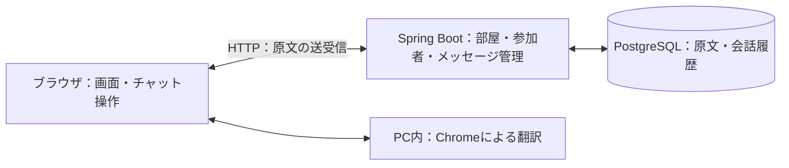

# 翻訳チャット / Translate Chat

[](https://github.com/zahin-dev/translate-chat/actions/workflows/ci.yml)


**慣れた言語で話そう！**

言語が異なる友人と、翻訳アプリに文章をコピーする手間なく会話するためのWebアプリです。ルームIDで同じ部屋に参加し、それぞれが選んだ言語でメッセージを読めます。1対1とグループでの雑談に対応しています。

現在の対応言語は日本語・英語です。「翻訳チャット」は仮の表示名です。

## 目次

- [できること](#できること)
- [開発・公開状況](#開発公開状況)
- [技術構成](#技術構成)
- [ローカルで起動する](#ローカルで起動する)
- [使い方](#使い方)
- [コマンド一覧](#コマンド一覧)
- [環境変数](#環境変数)
- [ディレクトリ構成](#ディレクトリ構成)
- [テスト・動作確認](#テスト動作確認)
- [困ったときは](#困ったときは)
- [現在の制約](#現在の制約)
- [関連資料](#関連資料)

## できること

- アカウントを作らず、表示名とルームIDで会話に参加。
- 部屋の作成、友人の招待、複数人での参加・退出。
- 相手のメッセージを、読む人が選んだ言語へ自動翻訳。
- 翻訳されたメッセージの原文を表示。
- 会話履歴の保存、再入室、過去のメッセージの読み込み。
- 日本語・英語の画面切り替えと、チャットのサイドバー幅の調整。

翻訳はPC版Chromeの機能を使い、利用者のPC内で処理します。翻訳サービスのAPIキーは不要です。原文はアプリのサーバーとPostgreSQLに保存し、翻訳結果はブラウザのメモリに一時保持します。

## 開発・公開状況

2026年10月18日時点の状態です。

| 項目 | 状態 |
|---|---|
| ローカル版 | 完成。Windows上で起動・会話・翻訳を確認済み。 |
| Docker版 | ローカルで起動、グループ会話、双方向翻訳、コンテナ再作成後の履歴保持を確認済み。 |
| ソースコード | [GitHubで公開中](https://github.com/zahin-dev/translate-chat)。 |
| 自動検証 | [JUnit・JavaScriptテスト・コンテナビルドが成功](https://github.com/zahin-dev/translate-chat/actions/runs/39104069979)。 |
| クラウド版 | Vercelプロジェクトを作成済み。Neon接続・環境変数設定・デプロイ・公開URLでの検証は準備中。 |
| アプリの公開URL | 未発行。現在はローカル環境で利用できます。 |

クラウド公開は **Vercel Hobby + Neon Free** を予定しています。手順と確認項目は [公開手順](docs/deployment.md) にまとめています。

## 技術構成

| 用途 | 使用技術 |
|---|---|
| サーバー・API | Java 21 / Spring Boot 3.5.16 / Spring JDBC |
| 画面 | HTML / CSS / JavaScript |
| 翻訳・言語判定 | Chrome Translator API / LanguageDetector API |
| データベース | PostgreSQL 18.6（Docker / 従来のローカル起動） |
| ビルド | Apache Maven 3.9（Docker）/ 3.9.16（従来起動） |
| テスト | JUnit / Spring Boot Test / Node.js標準テスト |
| 継続的な検証 | GitHub Actions |
| 実行環境 | Docker / Docker Compose。クラウドはVercel / Neon PostgreSQLを準備中 |



新着メッセージは2秒ごとに取得します。データベースの表の定義は [schema.sql](src/main/resources/schema.sql) を参照してください。

## ローカルで起動する

### Dockerで起動する（標準の方法）

必要なものは、Windows 64bit環境、PowerShell、Git、Docker Desktop（Linuxコンテナ）、PC版Chromeです。自動テストを行う場合はNode.jsも必要です。初回はインターネットからDockerイメージと依存ライブラリを取得します。Java・Maven・PostgreSQLをPCへ個別に導入する必要はありません。

初めてソースを取得する場合は実行します。

```powershell
git clone https://github.com/zahin-dev/translate-chat.git
cd translate-chat
```

Docker Desktopを起動し、プロジェクトのフォルダで実行します。取得済みの場合も、このコマンドから始められます。

```powershell
.\Start-Docker.ps1
```

準備完了後、**[http://localhost:8080/](http://localhost:8080/)** を開きます。アプリとDBはバックグラウンドで動きます。終了する場合は実行します。

```powershell
.\Stop-Docker.ps1
```

- アプリとDBの起動・停止をまとめて行います。DBの準備が整ってからアプリを起動します。
- 初回にDBパスワードを生成し、Git管理外の `.local/docker.env` に保存します。同じファイルを次回以降も使います。
- Docker用の会話履歴は名前付きボリューム `translate-chat-local_postgres-data` に保存します。通常の停止・コンテナ再作成では履歴を残します。Docker Desktop等からこのボリュームを削除すると履歴を失います。
- 従来の `.local/postgres/` の履歴とは別の保存先です。既存データを自動移行しません。`.local/docker.env` も接続に必要なため保管してください。
- アプリへの接続はこのPCの8080番ポートに限定し、DBのポートはPCへ公開しません。
- ソースを変更した場合も `.\Start-Docker.ps1` で再ビルドします。変更がない場合は `.\Start-Docker.ps1 -NoBuild` でビルドを省略できます。
- ポートを `-AppPort` で変更すると、次回以降もその番号で起動します。明示的に変更しない限り、保存済みの番号を引き継ぎます。

`localhost` は操作中のPCを指します。友人からの接続にはクラウド公開が必要です。Docker Composeはローカル用で、クラウドは同じ `Dockerfile.vercel` と外部のNeon DBを使う構成です。

### Dockerを使わない従来の起動方法

#### 必要なもの

- Windows 64bit環境とPowerShell。
- ソースの取得に使うGit。
- 自動翻訳に対応したPC版Chrome。利用できない環境でも原文で会話できます。
- 初回のツール・ライブラリ・翻訳用データのダウンロードに使うインターネット接続。
- テストを実行する場合はNode.js（GitHub Actionsでは24を使用）。

Java・Maven・PostgreSQLは初回準備スクリプトがプロジェクト内に導入します。ローカル起動にDockerは不要です。

#### 初回の準備

PowerShellで、プロジェクトを置きたいフォルダへ移動してから実行します。

```powershell
git clone https://github.com/zahin-dev/translate-chat.git
cd translate-chat
.\Setup.ps1
```

すでにソースを取得している場合は、そのフォルダで `.\Setup.ps1` を実行してください。このPCで準備済みの場合は、次の「アプリの起動」から始められます。

`Setup.ps1` はJava・Maven・PostgreSQLをダウンロードしてチェックサムを照合し、アプリのビルドとローカルDBの準備を行います。ツールは `.tools/`、DBのデータと生成したパスワードは `.local/` に保存します。Windows全体のPATHやデータベースサービスの登録は変更しません。Node.jsはこのスクリプトでは導入しません。

#### アプリの起動

プロジェクトのフォルダで実行します。

```powershell
.\Start-App.ps1
```

起動後、PC版Chromeで **[http://localhost:8080/](http://localhost:8080/)** を開きます。DBはアプリの起動スクリプトが起動するので、別途操作する必要はありません。

`localhost` は操作中のPCを指します。別のPCや海外の友人からアクセスするには、クラウド公開が必要です。

#### 終了

起動したPowerShellで `Ctrl + C` を押すとアプリを終了します。DBは起動したままなので、停止する場合は続けて実行します。

```powershell
.\Stop-Database.ps1
```

## 使い方

1. 表示名と「メッセージを読む言語」を選びます。
2. 「部屋を作る」でルームIDを発行し、友人に伝えます。
3. 友人は「部屋に参加」で同じIDを入力します。
4. 慣れた言語でメッセージを送信します。自分の発言は原文、相手の発言は選択した言語で表示します。
5. 必要に応じて「原文を見る」を開きます。退出後も同じルームIDで参加すれば、保存された履歴を読めます。

1台のPCで試す場合は、Chromeの別タブを開き、別の表示名・読む言語で参加します。

ホーム右上の「日本語 / English」を切り替えると、画面表示と「メッセージを読む言語」が同じ言語になります。その後、読む言語だけを手動で変更することもできます。選択は同じブラウザに保存します。

チャット画面のサイドバーは、会話との境界をドラッグすると幅を変更できます。境界にフォーカスして左右キーでも調整でき、ダブルクリックで既定幅に戻せます。スクロールバーは表示しませんが、会話履歴やメンバー欄はホイール・タッチパッド等でスクロールできます。

画面の再読み込みでは、そのタブの参加情報を使って会話を再開します。明示的に退出してから参加すると、新しい参加者として扱います。

## コマンド一覧

すべてプロジェクトのフォルダで、PowerShellから実行します。

| コマンド | 内容 |
|---|---|
| `.\Start-Docker.ps1` | DockerでアプリとDBをビルド・起動。標準の起動方法。 |
| `.\Start-Docker.ps1 -NoBuild` | 既存のイメージで起動。ソース変更後は通常の起動で再ビルド。 |
| `.\Start-Docker.ps1 -AppPort 8081` | Dockerのアプリを `http://localhost:8081/` で起動。 |
| `.\Stop-Docker.ps1` | DockerのアプリとDBを停止し、コンテナを除去。保存用ボリュームは維持。 |
| `.\Test-Docker.ps1` | 起動中のDocker版で会話と保存を検証。検証中にこのプロジェクトのコンテナを再作成。Node.jsが必要。 |
| `docker compose --env-file .local/docker.env logs --tail 80 app` | Docker版アプリの直近のログを表示。 |
| `.\Setup.ps1` | 初回のツール取得・ビルド・ローカルDB準備。 |
| `.\Start-App.ps1` | DBとアプリを起動。アプリの標準ポートは8080。 |
| `.\Start-App.ps1 -AppPort 8081` | アプリを別のポートで起動。開くURLは `http://localhost:8081/`。 |
| `Ctrl + C` | 起動中のアプリを終了。DBは停止しません。 |
| `.\Stop-Database.ps1` | このプロジェクトのローカルDBを停止。アプリ終了後に実行。 |
| `.\Test-App.ps1` | DBを起動し、翻訳処理のJavaScriptテストとJUnitを実行。Node.jsが必要。 |

## 環境変数

環境変数は、接続先などをコードの外から指定するための設定です。**ローカルでは起動スクリプトが設定するため、通常は手入力不要です。**

Docker用の `.local/docker.env` は `Start-Docker.ps1` が生成し、Docker Composeが読み込みます。

| 名前 | 内容 |
|---|---|
| `CHAT_DOCKER_PORT` | PC側のアプリのポート。標準8080。`-AppPort` で変更すると保存。 |
| `CHAT_DOCKER_DB_PASSWORD` | 初回生成したDocker用DBパスワード。次回以降も同じ値を使用。 |

Dockerのアプリには `compose.yaml` からDB接続先 `jdbc:postgresql://db:5432/translate_chat`、ユーザー `chat`、生成したパスワード、公開元 `http://localhost:ポート番号` を渡します。

| 名前 | 役割 | 従来のローカル起動での値・扱い | クラウドでの扱い |
|---|---|---|---|
| `SPRING_PROFILES_ACTIVE` | 実行環境の設定を選択 | 指定不要 | コンテナで `cloud` を指定済み |
| `PORT` | アプリの待受ポート | `Start-App.ps1` が設定。標準8080 | コンテナと `vercel.json` で8080を指定済み |
| `CHAT_BIND_ADDRESS` | アプリが接続を受け付けるアドレス | 標準 `127.0.0.1` | cloud設定で `0.0.0.0` を使用 |
| `CHAT_DB_URL` | PostgreSQLのJDBC接続URL | スクリプトが `jdbc:postgresql://127.0.0.1:55432/translate_chat` を設定 | Neonの接続先を設定。TLSを使用 |
| `CHAT_DB_USER` | DBユーザー名 | スクリプトが `chat` を設定 | 公開用DBのユーザー名を設定 |
| `CHAT_DB_PASSWORD` | DBパスワード | 初回生成し `.local/database-password.txt` から設定 | 公開先で秘密情報として設定 |
| `CHAT_PUBLIC_ORIGIN` | 送信を許可する公開URLのオリジン | 指定不要 | 必須。例：`https://YOUR_APP_HOST`。パスを含めない |
| `CHAT_TEST_DB_URL` | JUnit用DBの接続先 | 標準 `jdbc:postgresql://127.0.0.1:55432/translate_chat_test` | GitHub Actionsでテスト専用DBを指定 |

[.env.example](.env.example) は公開用設定の記入例です。**コピーしただけではSpring Bootは読み込みません。** 公開先の管理画面で環境変数として登録します。詳しくは [公開手順](docs/deployment.md#vercelで設定する値) を参照してください。

実際のパスワードや会話履歴をGitHubへ登録しないでください。`.local/`・`.tools/`・`.env`・Vercelのローカル接続情報はGit管理から除外しています。`.local/` を削除すると、会話履歴や接続に必要な情報を失います。

## ディレクトリ構成

```text
translate-chat/
├── .github/workflows/ci.yml          # 自動テスト・コンテナビルド
├── scripts/
│   ├── LocalEnvironment.ps1          # ローカルのJava・Maven・DBの管理
│   ├── DockerEnvironment.ps1         # Dockerの確認・専用設定・Compose呼び出し
│   └── DatabaseSetup.java            # ローカルDBの作成
├── src/
│   ├── main/
│   │   ├── java/jp/translatechat/     # API・会話処理・入力とアクセスの検証
│   │   └── resources/
│   │       ├── static/               # HTML・CSS・画面操作・翻訳・表示言語
│   │       ├── application.properties
│   │       ├── application-cloud.properties
│   │       └── schema.sql            # テーブル・インデックス定義
│   └── test/java/jp/translatechat/    # JUnitテスト
├── tests/translator.test.mjs         # 翻訳処理のJavaScriptテスト
├── tests/docker-smoke.test.mjs       # コンテナ経由の会話・保存の検証
├── docs/
│   ├── requirements.md              # 要件定義書
│   ├── basic-design.md              # 基本設計書
│   └── deployment.md                # 公開手順・進捗
├── .env.example                     # 公開用の環境変数の例
├── Dockerfile.vercel                # ローカル・公開で共用するイメージ定義
├── compose.yaml                     # ローカル用のアプリ・DB・保存領域
├── vercel.json                      # Vercel設定
├── pom.xml                          # Javaの依存関係・ビルド設定
├── Setup.ps1                        # 初回準備
├── Start-App.ps1                     # アプリ起動
├── Stop-Database.ps1                 # ローカルDB停止
├── Test-App.ps1                      # 自動テスト
├── Start-Docker.ps1                  # Docker版のビルド・起動
├── Stop-Docker.ps1                   # Docker版の停止（履歴を維持）
├── Test-Docker.ps1                   # Docker版の動作・保存の自動検証
└── README.md
```

実行時には、Git管理外の `.tools/`（ツール・ライブラリ）、`.local/`（DB・ログ・接続情報）、`target/`（ビルド結果）も作成されます。

## テスト・動作確認

Docker版を起動してから実行します。

```powershell
.\Test-Docker.ps1
```

架空の3人で部屋の作成・参加・送信・退出・再入室を確認し、不正な通信元からの送信を拒否することも確認します。途中で、このプロジェクトのアプリとDBのコンテナを再作成し、同じ参加情報と会話履歴を復元できるか検証します。検証中は一時的に接続できなくなるため、通常の会話中には実行しないでください。テスト用の部屋と発言はDBに残ります。

JUnitと翻訳処理のテストは、従来のローカル環境を準備した上で実行できます。

```powershell
.\Test-App.ps1
```

JUnitでは、通常利用とは別のDB `translate_chat_test` に対して、実際のHTTP通信と保存処理を確認します。JavaScriptのテストではChromeの翻訳機能を代替するテスト用処理を使い、翻訳準備・翻訳の失敗と再試行を確認します。実際の訳文の品質は、Chromeで別途確認します。

| 確認方法 | 確認内容・結果（2026年10月18日時点） |
|---|---|
| JUnit | 14件成功。部屋・参加・送信・履歴・入力制限・通信元の検証など。 |
| JavaScript | 翻訳処理の3件成功。 |
| Dockerの結合テスト | 1件成功。3人の会話・不正な通信元の拒否・退出・再入室・コンテナ再作成後の履歴保持を確認。 |
| GitHub Actions | 上記テスト、JavaScriptの構文チェック、公開用コンテナのビルドが成功。 |
| ローカルのChrome | 双方向翻訳・原文表示・3人での参加・退出・再入室・サーバー再起動後の履歴を確認。翻訳準備に失敗しても原文を送受信できることを確認。 |
| クラウドの公開URL | 未検証。デプロイ後に確認予定。 |

ローカルのChrome操作は開発時のAIによる動作検証です。利用者と友人による実利用の確認とは区別しています。

## 困ったときは

| 症状 | 確認すること・対処 |
|---|---|
| Dockerエンジンに接続できない | Docker Desktopを起動し、Linuxコンテナを使っていることを確認してください。 |
| Dockerで8080番ポートを使えない | 従来のアプリが起動中でないか確認するか、`.\Start-Docker.ps1 -AppPort 8081` を使ってください。 |
| Dockerイメージの取得に失敗する | 接続状況を確認し、`.\Start-Docker.ps1` を再実行してください。ビルド中のJavaイメージ取得が失敗する場合は、`docker pull eclipse-temurin:21-jre-jammy` と `docker pull maven:3.9-eclipse-temurin-21` で公式イメージを先に取得してから再実行できます。 |
| Docker版が起動完了しない | `docker compose --env-file .local/docker.env logs --tail 80 app` でログを確認してください。DBのログは末尾の `app` を `db` に変えて確認できます。 |
| Docker用DBはあるが設定ファイルがないと言われる | `.local/docker.env` を元のバックアップから復元してください。別のパスワードで自動初期化しない設計です。 |
| 「先に Setup.ps1 を実行してください」と表示される | プロジェクトのフォルダで `.\Setup.ps1` を実行してから起動してください。 |
| ダウンロード・初回準備に失敗する | 接続状況とエラーを確認してください。チェックサム不一致の場合は確認処理を無効にせず、対象ファイルと取得元を確認してください。 |
| 8080番ポートが使用中 | 既存のアプリを確認するか、`.\Start-App.ps1 -AppPort 8081` で起動してください。 |
| PostgreSQLの起動に失敗する | `.local/postgres.log` と、55432番ポートの競合を確認してください。 |
| DBのパスワードファイルがないと言われる | `.local/` を初期化せず、元のパスワードファイル・バックアップを確認してください。 |
| `node` が見つからずテストできない | Node.jsが必要です。導入後にPowerShellを開き直し、`node --version` で確認してください。 |
| 翻訳が始まらない・準備に失敗する | 対応するPC版Chromeで開き、接続状況を確認して「翻訳を準備する／再試行」を実行してください。利用できない間も原文で会話できます。 |
| 別のPCから `localhost` に接続できない | `localhost` は各PC自身のアドレスです。友人との利用にはクラウド公開を行います。 |
| `.env` に値を書いても反映されない | このアプリは `.env` を自動で読み込みません。起動プロセス、または公開先の環境変数として設定してください。 |
| 公開先で起動・送信に失敗する | DBの接続設定と `CHAT_PUBLIC_ORIGIN` を確認してください。ブラウザで開いたURLのオリジンと設定値を一致させます。 |

## 現在の制約

- 翻訳は日本語・英語に対応しています。スマートフォンでの自動翻訳は対応範囲に含みません。
- Chromeの翻訳機能には利用条件があり、初回は翻訳用データのダウンロードが必要です。詳細は [Chrome公式資料](https://developer.chrome.com/docs/ai/translator-api) を参照してください。
- 短文・日英混在・固有名詞では、言語判定や訳文が不自然になる場合があります。「原文を見る」で確認できます。
- ルームIDを知る人は参加でき、過去の会話も読めます。表示名による本人確認はありません。
- 表示名は30文字、メッセージは2,000文字以内です。履歴は最近100件から表示し、以前の会話を追加で読み込めます。
- 部屋の期限、履歴の自動削除、管理画面、メッセージ編集は未実装です。

## 関連資料

| 資料 | 内容 |
|---|---|
| [要件定義書](docs/requirements.md) | 目的・利用者・機能・対象範囲。 |
| [基本設計書](docs/basic-design.md) | 画面・処理・データの設計。 |
| [公開手順](docs/deployment.md) | Vercel・Neonの構成、設定、公開までの残作業。 |
| [DB定義](src/main/resources/schema.sql) | 実装で使用するテーブルと制約。 |
| [自動検証の定義](.github/workflows/ci.yml) | GitHub Actionsの実行内容。 |
